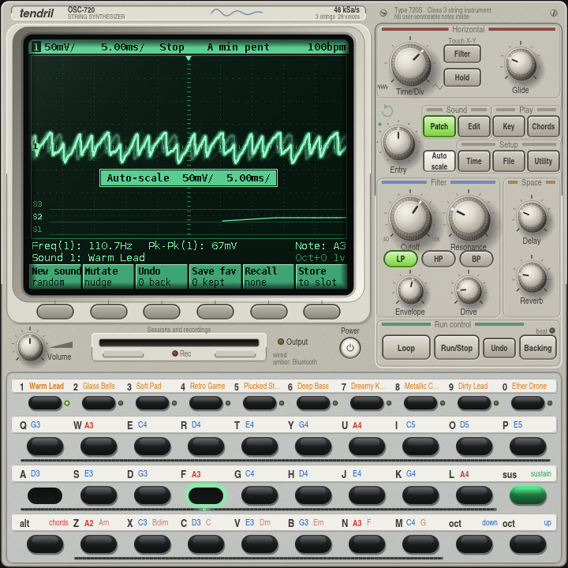

# Tendril

A pocket string synthesiser for the Hackberry Pi CM5 (720×720 screen, Q20 keyboard).
Each keyboard row is a string: hold a key and press another on the same row and the
note *slides* there. Everything is locked to a scale, so it sounds musical whatever
you press. Original code and interface; inspired by the playing mechanics of slide-string
pocket synths, with no code, firmware or branding taken from any of them.



```bash
tendril
```

or tap **Tendril** in the app grid. `tendril --windowed` runs it in a window,
`tendril --help` lists the options.

## The front panel

Tendril is drawn as one piece of bench equipment: a storage-scope tube on the left, knob
groups on the right, a key deck along the bottom. Nothing scrolls and there are no pages;
secondary functions live behind the six soft keys under the tube, the way they do on a
real scope.

| Part | What it does |
|---|---|
| Tube | The live output waveform, triggered so it stands still. Readouts: volts/div, time/div, key and scale, tempo, measured frequency and peak-to-peak, the note being played. The three thin traces at the bottom are each string's pitch over the last 2.5 s, so slides show as ramps. Touch the trace for X-Y sound control. |
| Soft keys (six under the tube) | The current menu. Tap a label or the key under it. A key that shows a value takes the Entry knob on the first tap; tap again to step it or carry it out. |
| Menu keys | Patch, Edit, Key, Chords, Time, File, Utility choose what the soft keys do. Auto scale fits the picture to the note. |
| Horizontal | Time/Div changes only the picture, never the pitch. Glide sets the slide speed. Filter and Hold choose and freeze the X-Y mapping. |
| Entry | Turns whichever soft key is selected. |
| Filter | Cutoff, Resonance, Envelope, Drive, and LP / HP / BP. |
| Space | Delay and Reverb amounts. |
| Run control | Loop (count in, record, play, overdub), Run/Stop, Undo, Backing start/stop. |
| Under the tube | Volume, the file slot (opens the File menu), output and record lamps. |
| Key deck | The Q20 keyboard, drawn. Legends show the letter, the note it plays now, and chord names on the bottom row. Tap or drag along a row to play and slide by touch. The number row holds the ten sounds. |

**Knobs:** drag up or down to turn, drag sideways for fine adjustment (five times slower).
The knob with the green dot is the one the keyboard turns: `Ctrl`+`Left`/`Right` fine,
`Ctrl`+`Up`/`Down` coarse; the trackpad wheel turns it too. `Ctrl`+`1`‥`6` press the soft keys.

More pictures: [Edit](docs/shots/1-edit.png), [Key](docs/shots/2-key.png), [Chords](docs/shots/3-chords.png),
[Time](docs/shots/4-time.png), [File](docs/shots/5-file.png), [Utility](docs/shots/6-utility.png),
[Help](docs/shots/7-help.png), [Status](docs/shots/8-status.png), [Key test](docs/shots/9-keytest.png).

## Play it in ten seconds

| Do this | It does this |
|---|---|
| Press `Q`‥`P`, `A`‥`L`, `Z`‥`M` | Three strings: high, middle, low. Left to right goes up the scale. |
| Hold a key, press another on the same row | The note slides (no re-attack). Let the newer key go and it slides back. |
| Hold a shape across rows, re-finger it | The whole chord glides. |
| `Shift` (hold) | Chromatic: keys step in semitones. |
| `Space` (hold) | Sustain. Keys pressed on a sustained string slide it. |
| `Backspace` | Panic: silence everything. |
| `Enter` | Loop pedal: count-in → record → (press again) loop → (again) overdub. |
| `Left` / `Right`, `Up` / `Down` | Pitch bend, octave (held notes sweep). On the Q20 these are on the symbol layer. |
| `1`‥`9`, `0` | Sounds 1‥10 (number layer on the Q20). |
| `Alt` + `Z`‥`M` | Backing chords I‥VII. `$`, or the alt key on the deck, turns the bottom row into chord keys. |
| `Ctrl` + `R` / `Z` / `F` / `N` | New random sound / undo / save favourite / mutate. |
| `Tab`, `Esc` | Next menu, back to the Patch menu. |
| Drag on the trace | X-Y sound control (filter, vibrato, timbre, space, bend). |

The full guide is built in: **Utility → Help** (or `Ctrl`+`H`), three pages.

## What is in it

- **Strings**: three monophonic strings with true continuous portamento (pitch ramps in the
  oscillator, the envelope is not retriggered), per-sound glide time plus a global glide speed.
- **Scale lock**: major, natural minor, major/minor pentatonic, blues, dorian, mixolydian,
  chromatic; any root; default A minor pentatonic.
- **Synth**: 28-voice pool; per voice two band-limited oscillators (sine, triangle, saw, pulse)
  plus unison copy, sub and noise, FM, ADSR, a zero-delay state-variable filter (low/high/band-pass)
  with its own envelope, vibrato, LFO to cutoff/amplitude/pulse-width, saturation. Master chorus,
  tempo-synced delay, reverb, limiter + soft clip (output can never exceed full scale).
- **Sounds**: ten factory sounds in slots 1‥0, a randomiser that invents playable instruments
  (every result is loudness-normalised), mutate, undo, favourites, an all-parameters editor (Edit menu: eight pages of five parameters on the soft keys).
- **Backing**: diatonic triads/sevenths from the scale. Tap up to eight chords for a looping
  progression, or latch one chord, or latch drone notes. Sustain / pulse / arpeggio styles.
  The backing keeps the sound it started with while you change the lead.
- **Looper**: event-based (notes, slides, bends, XY moves, sound changes), count-in, bar-snapped,
  up to 64 bars, six layers, undo, stop/start, clear. Each layer keeps its own sound. Follows tempo.
- **Saving**: sounds, favourites, sessions (settings + sounds + backing + loops) and WAV export
  under `~/Tendril/`. Key bindings are editable in `~/Tendril/keymap.json`.
- **Listen** (optional): estimates key and tempo from the default audio input with confidence
  values. *This Hackberry has no microphone*, so it reports that instead of guessing.

## Build, install, remove

```bash
./scripts/build.sh       # fetches audio headers into third_party/ (no root), builds, runs the tests
./scripts/install.sh     # installs to ~/.local/opt/tendril + launcher + `tendril` command
./scripts/uninstall.sh   # removes it (add --purge to also delete ~/Tendril)
```

Needs: `g++`, `cmake`, `qt6-base-dev` and the PipeWire/ALSA runtime libraries — all already on this
machine. Nothing is installed system-wide and nothing starts at boot.

Tests:

```bash
./build/tendril_tests                                   # 324 engine checks (offline rendering)
./build/tendril_tests --bench                           # CPU at full polyphony
QT_QPA_PLATFORM=offscreen ./build/tendril --selftest    # 58 checks through the real app + audio thread
QT_QPA_PLATFORM=offscreen ./build/tendril --audio null --render docs/shots   # redraw the pictures
```

## Layout of the code

| Path | What |
|---|---|
| `core/` | The engine, no GUI or device dependencies: `voice.h` (synth voice), `fx.h`, `scale.h`, `instrument.*` (strings, backing, looper, mixer), `presets.*` (sounds, randomiser), `analysis.*` (key/tempo) |
| `audio/` | PipeWire backend (C), ALSA fallback, silent clock |
| `app/` | Qt 6 interface, all custom-painted: `hw.*` (knobs, key caps, plastic, lamps), `panel.cpp` (chassis, control groups, key deck), `crt.cpp` (tube, soft-key menus, scope), `mainwindow.*` (input, actions, files), key map, self-test |
| `tests/` | Engine tests and benchmark |
| `docs/HARDWARE.md` | What was found on this Hackberry and what it means |
| `docs/STATUS.md` | What is tested, what still needs a person, known limits, and a five-minute test list |

## Honest status

See [docs/HARDWARE.md](docs/HARDWARE.md) for the audit and [docs/STATUS.md](docs/STATUS.md) for what is
verified, what still needs a human with the device in hand, and known limits.
