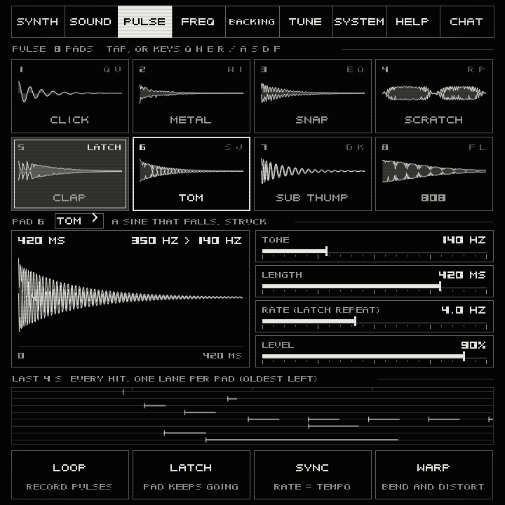
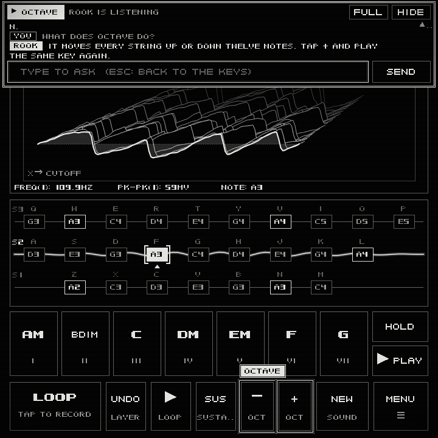
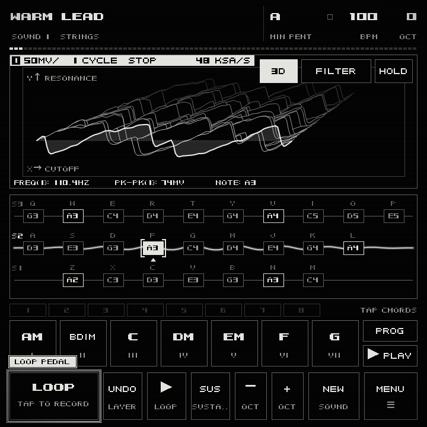

# How to use venv-vrequency

A guide to playing the synth, page by page. Everything here describes version 0.13.0 with the
Track and Backing pages taken out (the way to 1.0), and the default key bindings.

The short version is also built into the app: press `Ctrl`+`H`, or tap Menu and then the Help tab.

## Contents

1. [Start and quit](#1-start-and-quit)
2. [Your first minute](#2-your-first-minute)
3. [The Synth page](#3-the-synth-page)
4. [Playing the strings](#4-playing-the-strings)
5. [The scope and touch pad](#5-the-scope-and-touch-pad)
6. [Sounds](#6-sounds)
7. [Chord pads](#7-chord-pads)
8. [Pulse](#8-pulse)
9. [The loop pedal](#9-the-loop-pedal)
10. [Key, scale and tempo](#10-key-scale-and-tempo)
11. [Saving and recording](#11-saving-and-recording)
12. [System page](#12-system-page)
13. [All the keys](#13-all-the-keys)
14. [When something is wrong](#14-when-something-is-wrong)
15. [Chat with a copilot](#15-chat-with-a-copilot)
16. [Asking Rook while you play (the chat dock)](#16-asking-rook-while-you-play-the-chat-dock)
17. [The tour](#17-the-tour)

## 1. Start and quit

Start it from the app grid ("venv-vrequency"), or from a terminal:

```bash
vrequency
```

It opens full screen. To quit, press `Ctrl`+`Q`, or tap Menu, then System, then Quit. Quitting
saves your setup (sounds, key, tempo, settings) and it comes back the same next time.

`vrequency --windowed` runs it in a 720×720 window instead.

## 2. Your first minute

1. Press `A`, then `S`, then `D`. Each key is a note on the middle string.
2. Hold `A` and press `F` while still holding. The note slides up instead of starting again.
   Let go of `F` and it slides back to `A`.
3. Press `1` to `9` and `0` to try the ten sounds. On the Q20 the digits are on the number layer.
4. Drag a finger across the scope at the top of the screen. That changes the tone.
5. Tap one of the chord pads (Am, C, Em ...). It holds that chord so you can play over it; tap
   another to change chord, or the same one again to let it go.
6. Press `Backspace` if anything gets stuck. It silences everything.

Every key is locked to a scale, so nothing you press is a wrong note.

## 3. The Synth page

This is the instrument itself, and the page the app opens on. Its tab is called Synth.


From top to bottom:

| Part | What it shows | What tapping it does |
|---|---|---|
| Header, left | Sound name, slot number, how many voices are sounding | Opens the Sound page |
| Header, right | Key, scale, tempo with a beat lamp, octave | Opens the Tune page |
| Level strip | Output level, as a row of segments | Nothing |
| Scope | The real output wave, with frequency and level readouts | Dragging is the touch pad (section 5) |
| Strings | Three strings with each note's key letter above it | Press to play, drag to slide |
| Chord pads | The seven chords of the current key, with their mode and Play / Stop | Holds a chord or a drone (section 7) |
| Bottom row | Loop, Undo, loop play/stop, Sus, octave − and +, New, Menu | See below |

The bottom row:

- **Loop**: the loop pedal (section 9).
- **Undo**: removes the last loop layer.
- **▶ / ■**: starts or stops the loop.
- **Sus**: sustain stays on until you tap it again.
- **− / +**: octave down or up.
- **New**: invents a new random sound.
- **Menu**: opens the Sound page, which has the tab strip along the top for all the other pages:
  Synth, Sound, Pulse, Tune, System, Help and Chat, in that order.

`Tab` steps through the pages and `Esc` returns to Synth.

A small tag can appear under the sound name: "Limit" when the output is loud enough to be held
back, "REC" while recording to a file, and "No audio device" when there is nothing to play through.

## 4. Playing the strings

The three letter rows of the keyboard are three strings. Left to right goes up the scale.

| Keys | String |
|---|---|
| `Q` to `P` | High |
| `A` to `L` | Middle |
| `Z` to `M` | Low |

- **Slide:** hold one key and press another on the same row. The pitch glides to the new note
  without restarting. Release the newer key and it glides back.
- **Chords that glide:** hold a shape across two or three rows and move your fingers to a new shape.
  Each string slides to its new note.
- **Sustain:** hold `Space`. Released notes keep ringing, and new keys on a ringing string slide it.
- **Chromatic:** hold `Shift`. Keys then step in semitones, which lets you reach notes outside the scale.
- **Bend:** hold `Left` or `Right` (also `[` and `]`) to bend the pitch down or up.
- **Octave:** `Up` and `Down` (also `=` and `-`). Held notes sweep to the new octave.
- **Touch:** press a note box on screen to play it, and drag along the string to slide.

Notes with a bright frame are the root of the key. While a string sounds, a pair of brackets shows
where the pitch really is, so you can watch a slide travel.

On the Q20 the arrows and digits are on the symbol and number layers.

## 5. The scope and touch pad

The scope shows the sound actually leaving the synth. It holds the wave still and picks its own
scale. The readouts along its edges are the scale per division, the measured frequency and note,
and the level. None of this changes the sound.

Dragging on the scope does change the sound. Left to right is one control (X) and bottom to top is
another (Y). The button in the scope's corner shows which pair is active, and tapping it moves to
the next pair. `Ctrl`+`G` does the same.

| Mapping | Left to right (X) | Bottom to top (Y) |
|---|---|---|
| Filter | Cutoff | Resonance |
| Wobble | Cutoff | Vibrato |
| Morph | Timbre | Drive |
| Space | Delay | Reverb |
| Bend | Pitch | Cutoff |
| Glitch | Coarse | Grit |

**Hold** (next to it) keeps the position when you lift your finger. With Hold off, the sound
returns to normal when you let go.

### Glitch


Glitch crushes everything you hear (lead, chord pads, loop and pulses) into a rough, low-quality digital
sound for as long as your finger is on the pad.

- **Left to right (Coarse):** the sound gets blockier and more metallic.
- **Bottom to top (Grit):** the sound gets rougher and noisier.

While it is on, the scope leaves coloured copies of the wave streaking away diagonally. The white
wave on top is still the real sound, which now looks like steps. Further right makes the streaks
spread wider, and further up makes them last longer. Lift your finger and both the sound and the
picture go back to normal. `Backspace` (panic) also switches it off.

## 6. Sounds


**Pick a sound.** Tap one of the ten slots, or press `1` to `9` and `0`.

**Make a new one.**

- **New sound** (`Ctrl`+`R`) invents a complete new instrument.
- **Mutate** (`Ctrl`+`N`) changes the current sound a little.
- **Undo** (`Ctrl`+`Z`) goes back one step. The button shows how many steps are stored.

**Shape it.** The eight sliders are the quick controls: Cutoff, Reso, Attack, Release, Glide,
Drive, Delay and Reverb. Drag one to change it. **All parameters** swaps them for every parameter
the sound has, twelve to a page, with Prev and Next at the bottom.

**Keep it.** There are two places:

- **A slot.** Tap **Store**, then tap the slot to put it in. This replaces what was in that slot and cannot be undone.
- **A favourite.** Tap **Save** (`Ctrl`+`F`). Favourites are listed at the bottom of the page, six
  to a page. Tap one to recall it. The page button shows `‹ 1/2 ›`: tap its left half to go back a page,
  its right half to go forward; both wrap round. To remove one, tap **Delete** and then the favourite.
  Saving under a name you already use updates that favourite (the toast says "Updated ...") instead of
  adding a copy. Delete, Store and Erase only stay armed while you stay on their page.

Factory sounds can be put back at any time: System page, **Factory sounds**. That overwrites slots
1 to 0. It leaves your own favourites alone and puts back any of the five dream sounds you deleted.

### Dream sounds

Five favourites are there from the first start: **Haze**, **Fuzz**, **Teeth**, **Bend** and
**Grain**. They are for slow, soft, washed-out playing. Each is built around a sine wave, so the
scope draws a round wave instead of the jagged one Warm Lead makes, and each adds its own kind of buzz.


| Sound | What it is |
|---|---|
| Haze | A sine with a quiet sine an octave above it. The plainest of the five. |
| Fuzz | A sine pushed into soft distortion, with a low note underneath. |
| Teeth | A sine with a quiet, bright sawtooth riding on it, which shows as small teeth on the wave. |
| Bend | A sine whose shape is bent by a second sine. The dents drift slowly as you hold a note. |
| Grain | A triangle and a sine that beat against each other, with a little hiss and a slow tremolo. |

All five fade in gently, ring on for a couple of seconds after you let go, wobble slowly in pitch
and sit in a lot of chorus, echo and reverb. They suit held notes, slides and chords on three
strings more than fast playing. If the wash is too much, pull **Reverb** and **Delay** down.

To put one on a number key: tap it, tap **Store**, then tap a slot. If you delete one, it stays
deleted until you use **Factory sounds** on the System page.

## 7. Chord pads

The seven chord pads under the strings are the chords that belong to the current key (a small
numeral is a minor chord). What a tap does depends on the mode, shown on the upper button beside
the pads (tap it to change):

| Mode | A chord tap ... |
|---|---|
| Hold | Plays that one chord until you pick another; tapping it again lets it go |
| Drone | Switches a drone note for that chord on or off |

A held chord and drones can sound together: set up the drones, switch to Hold and pick a chord over
them. The lower button, **Stop**, silences the pads but remembers what they held, and **Play** brings
it back. Panic (`Backspace`) stops them too.

The pads take the sound that is live when they start, so you can change the lead without changing
the chords. To give them a new sound, stop them, choose the sound, then tap a chord.

From the keyboard, hold `Alt` and press `Z` to `M` for chords one to seven. `$` turns the whole
bottom row into chord keys until you press it again.

## 8. Pulse



The Pulse page has eight **pulse pads**: short, exact sounds made of clicks, ticks, noise, pure
sine tones, pulses and the silence between them. There is no step sequencer; you play them, latch
them, sync them to the tempo and record them with the loop pedal.

**Play the pads.** Tap a pad, or use the keyboard: `Q` `W` `E` `R` (or `U` `I` `O` `P`) are pads 1
to 4, `A` `S` `D` `F` (or `H` `J` `K` `L`) pads 5 to 8. The bottom row still plays the low string.
A tap also **selects** the pad; `Left` / `Right` select the pad before or after without playing it.
Each pad shows a small picture of its sound. The picture is made by running the pad's own
generator, the same code the audio uses, so it is the sound you hear (drawn again whenever a
setting changes).

**The eight kinds.** Pad *n* starts as the *n*-th kind, but any pad can be any kind (**Type**).
What **Tone** means depends on the kind:

| Kind | What it is | Tone | Length | Rate |
|---|---|---|---|---|
| Click | a damped cosine: one spike and a short ring | the ring, Hz | how fast it dies | latch repeat |
| Tick | 1 to 3 samples at full height, nothing else | width: 16 kHz and up 1 sample, 8 kHz and below 3 | not used | latch repeat |
| Noise burst | white noise with a fast decay | low-pass on the noise | its decay | latch repeat |
| Sine blip | a pure sine with soft edges | pitch | how long | latch repeat |
| Gated tone | a pure sine switched on and off | pitch | how long | gates a second |
| Pulse train | clicks at a steady rate | each click's ring | how long | clicks a second |
| Sub thump | a low sine falling from four times Tone to Tone in about 15 ms | where it falls to | its decay | latch repeat |
| Hiss | band-passed noise that swells (first 35 %) and fades | the band | the whole swell | latch repeat |

**The selected pad.** The big picture shows its sound over its whole length, with the length at the
top left and, at the top right, what it holds (clicks, gates, samples, or its tone). The four
sliders beside it set **Tone** (20 Hz to 18 kHz), **Length** (1 ms to 2 s), **Rate** (0.25 to 200 Hz)
and **Level**; the first three move in octaves.

**Last 4 s.** The strip under it has one lane per pad. Every hit, every click of a pulse train and
every gate of a gated tone is a tick at the moment the engine played it, oldest on the left; a long
sound (a hiss, a blip) is a thin bar for its length.

**The soft keys.**

| Key | Does |
|---|---|
| Loop | the loop pedal (the same as `Enter`): pad taps made while it records go into the loop and play back with the pad's settings of the moment |
| Latch | the selected pad keeps going until you tap it (or Latch) again. A gated tone or pulse train runs without end; any other kind is hit again Rate times a second. Several pads can be latched; `Backspace` stops them all |
| Sync | every pad's Rate snaps to the nearest division of the tempo (from four bars to 1/512), shown beside the rate; latched one-shots then fall on the beat clock's grid, in time with the loop |
| Type | the selected pad's next kind |

The pads' settings and Sync are saved in your state and in sessions; latches are not, so nothing
starts by itself. Latched repeats are not written into a loop, only taps.

## 9. The loop pedal

One button, or the `Enter` key, does everything. The Loop button on the Synth page always says what
the next tap will do.

1. Press `Enter`. The button counts you in.
2. Play. The button shows REC and the bar number.
3. Press `Enter` again. Recording runs to the end of the bar, then your phrase loops.
4. Press `Enter` again to add a layer on top (DUB), and once more to finish the layer.

| Do this | Key | Button |
|---|---|---|
| Remove the last layer | `Ctrl`+`U` | Undo |
| Stop or restart the loop | `Ctrl`+`L` | ▶ / ■ |
| Erase the loop | `Ctrl`+`D` | (keyboard only) |

A loop can be up to 64 bars with six layers. Each layer remembers the sound it was played with,
and the loop follows the tempo if you change it.

Loop volume is on the System page.

## 10. Key, scale and tempo


- **Key**: tap one of the twelve notes. `Ctrl`+`K` steps up a semitone.
- **Scale**: Major, Natural minor, Major pentatonic, Minor pentatonic, Blues, Dorian, Mixolydian,
  Chromatic. `Ctrl`+`S` steps to the next one. With `Shift` held as well, both shortcuts go the
  other way.
- **Octave**: moves the whole instrument up or down.
- **String gap**: how far apart the three strings are tuned, in semitones.
- **Bend range**: how far the bend keys move the pitch.
- **Tempo**: the − and + buttons, or tap the **Tap** button in time (`Ctrl`+`T`).
- **Click**: the metronome (`Ctrl`+`M`).
- **Glide speed**: makes every slide faster or slower. All the way down is instant.

**Listen** tries to work out the key and tempo of music playing nearby. It needs a microphone,
and this Hackberry does not have one, so it will say so.

## 11. Saving and recording

Everything is kept in the `vrequency` folder in your home folder.

| What | How | Where it goes |
|---|---|---|
| Your setup | Automatic when you quit | `state.json` |
| A favourite sound | Sound page, Save, or `Ctrl`+`F` | `favourites/` |
| A session: sounds, chord pads, loops and the pulse pads together | System page, Save session | `sessions/` |
| A recording of what you hear | System page, Record, or `Ctrl`+`E`. The same again stops it. | `recordings/` |

**Listening back.** System page, **Play last** (or `Ctrl`+`W`) plays your newest recording through
the speaker. The same again stops it. You can play along while it runs.

To load a session, tap it in the list on the System page, then start the loop, or tap a chord.
Sessions saved by earlier versions load too; their track and chord progression are left out.

## 12. System page


- **Master volume** and **Loop volume**.
- **Touch pad mapping** and **Hold**: the same as the buttons on the scope.
- **Chord row**: the bottom letter row plays chords (same as `$`).
- **Record**, **Play last** (listen to the newest recording), **Save session** and the list of saved sessions.
- **Key test**: shows which keys the keyboard reports, for checking how many it can read at once.
- **Status**: the audio device in use, how hard the engine is working, and where files are kept.
- **Panic**: all notes off (same as `Backspace`).
- **Loop fix**: shifts recorded loops earlier or later in milliseconds. Change it if your loops
  play back out of time with what you played.
- **Factory sounds**: restores slots 1 to 0 and puts back any deleted dream sounds.
- **Quit**.

## 13. All the keys

Playing:

| Key | Does |
|---|---|
| `Q`‥`P`, `A`‥`L`, `Z`‥`M` | High, middle and low strings |
| `Shift` (hold) | Chromatic |
| `Space` (hold) | Sustain |
| `Backspace` | Panic |
| `Enter` | Loop pedal |
| `Left` / `Right`, or `[` / `]` | Bend down / up |
| `Down` / `Up`, or `-` / `=` | Octave down / up |
| `1`‥`9`, `0` | Sounds 1 to 10 |
| `Alt` + `Z`‥`M` | Chord pads I to VII |
| `$` | Bottom row plays chords, on and off |
| `Tab` / `Esc` | Next page / back to Synth |

Commands, with `Ctrl` held:

| Key | Does | Key | Does |
|---|---|---|---|
| `R` | New sound | `U` | Undo loop layer |
| `N` | Mutate | `L` | Loop play / stop |
| `Z` | Undo sound | `D` | Clear loop |
| `F` | Save favourite | `E` | Record WAV |
| `K` | Key up | `W` | Play last recording |
| `S` | Next scale | `Q` | Quit |
| `T` | Tap tempo | `H` | Help |
| `M` | Metronome | `O` | Tour |
| `G` | Next touch-pad mapping | `V` | Scope: 3D stack or line |
| `P` | Strings / Poly keyboard | `C` (hold) | Open the filter |
| | | `X` (hold) | Close the filter |
| `Y` | Chat dock: ask Rook on this page (`Shift`: the Chat page) | | |

On the Pulse page only:

| Key | Does |
|---|---|
| `Q` `W` `E` `R`, or `U` `I` `O` `P` | Pads 1 to 4 |
| `A` `S` `D` `F`, or `H` `J` `K` `L` | Pads 5 to 8 |
| `Left` / `Right` | Select the pad before / after |

To change any binding, edit `keymap.json` in the `vrequency` folder and restart the app. Deleting
that file restores the defaults.

## 14. When something is wrong

| Problem | Try this |
|---|---|
| No sound, and "No audio device" under the sound name | The Bluetooth speaker has dropped. Reconnect it, then check Output on the System page. |
| Sound on a Bluetooth speaker plays well for a few seconds, then stutters, again and again | Close the Bluetooth settings window. While it is open the device keeps searching for other devices, and that interrupts the music. |
| A note is stuck | `Backspace`. |
| Notes come out late | Normal on the built-in speaker: it is Bluetooth and runs about 0.2 s behind. Wired headphones do not. |
| Loops play back early or late | System page, Loop fix. Adjust in steps until a recorded bar lines up. |
| Some keys do not sound when held together | Open Key test on the System page and hold the same keys. A key missing there is a limit of the keyboard, not the synth. |
| A slot was overwritten by mistake | Storing to a slot cannot be undone. Factory sounds on the System page puts the ten originals back, replacing anything else you stored in slots. |
| Pulse taps in a loop land late | The Bluetooth speaker is late, so you tap late. System page, Loop fix moves recorded taps earlier; raise it if they land late, lower it if early. |
| The sound is distorted or quiet with "Limit" showing | Lower Master volume, or the sound's Drive. |

To reconnect the speaker from a terminal, list the paired devices to find its address
(the Hackberry's built-in speaker is the one named `XWF-M18-M28-M38`), then connect to it:

```bash
bluetoothctl devices
```

```bash
bluetoothctl connect XX:XX:XX:XX:XX:XX
```

## 15. Chat with a copilot


The last tab, **Chat**, is a conversation between you and an AI copilot (for example the agent Rook, or
Claude Code) that is connected to the app through its control socket. It can play notes, change the sound,
shape and play the pulse pads and look at the screen while you talk. The commands it uses are in
[CONTROL.md](CONTROL.md). The socket is a local file only your user can open; `vrequency --no-control`
switches it off, and then the Chat page simply stays quiet.

- **Type** on the keyboard: on this page letters type instead of playing strings. `Enter` sends,
  `Backspace` deletes a letter, `Up` / `Down` (or a finger drag on the history) scroll, `Esc` leaves the page.
  The **Send** button sends by touch. `Tab` and the `Ctrl` commands still work.
- **Hotkey**: `Ctrl`+`Shift`+`Y` jumps to this page from any page, and `Ctrl`+`Y` here takes you back to where
  you were. (On the other pages `Ctrl`+`Y` opens the chat dock instead, chapter 16. It is bound as `chat`
  in `keymap.json`; the other `Ctrl` letters are unchanged.)
- The copilot's messages have a white tag with its name; yours have an outlined `YOU`. A `?` after the
  name means it is asking you something, `tip` marks a suggestion.
- **The ticker**: when the copilot says something while you are on another page, the message appears in a
  two-line strip at the bottom of the screen for about seven seconds, and the Chat tab shows how many are
  unread (`Chat 2`). It never takes the keyboard away, so you can keep playing; it does cover the
  bottom row of controls while it shows. Touch it, or press `Ctrl`+`Y`, to answer in the chat dock (chapter 16).
- **`copilot: listening`** at the top right means a copilot is connected and waiting for you
  (it has asked for your messages in the last 45 seconds, or is waiting right now); otherwise it says
  `copilot: not connected`. Messages you type then wait for it: they are kept.
- The last 200 messages are kept between runs.


## 16. Asking Rook while you play (the chat dock)



You do not have to leave the page you are on to talk to the copilot. Press `Ctrl`+`Y` on any page
except Chat and a **dock** opens over the bottom of the screen: the last two or three messages, an
input line and Send. The page behind it stays visible and keeps working above the dock.

- **Keys.** `Ctrl`+`Y` opens the dock and gives it the keyboard: letters type (they do not play strings),
  `Enter` sends, `Backspace` deletes, `Up` / `Down` scroll. `Esc` gives the keyboard back to the page and
  leaves the dock showing, so the keys play again; `Esc` once more closes the dock. `Ctrl`+`Y` while the dock
  is open switches the keyboard between the two. `Ctrl`+`Shift`+`Y` opens the full Chat page. By touch:
  tap the input line to type, **Send**, **Full** (the Chat page), **Hide**.
- **From the ticker.** When Rook speaks while the dock is closed, the ticker shows the message; touch it, or
  press `Ctrl`+`Y`, to answer straight away.
- **Pointing.** Rook can ring the controls it is talking about with a pulsing double outline, sometimes with a
  small caption tag next to it. The dock's header then says what is being discussed (`▸ OCTAVE`). The highlight
  goes away after a few seconds, or as soon as you change page. If the dock would cover what Rook points at, it
  gets shorter or moves to the top of the screen. When you answer, your message tells Rook which page you
  were on and what was highlighted, so "what does this do?" works.
- **On the Help page** every row is touchable. Tap a row and the dock opens with the question already started
  ("What does "Enter: loop pedal ..." do?"); press `Enter`. **Ask Rook** at the top opens the dock for the section you
  are reading. Rook can highlight a row ("the Loop pedal row") while it explains.




Rook needs to be connected (the dock says `Rook is listening`); if it is not, your messages wait for it.
The commands Rook uses are in [CONTROL.md](CONTROL.md).

## 17. The tour


The tour is a picture of every page with a card for every control on it. Nothing in it is live: it never plays,
never changes your sound or settings, and the keys do not reach the synth while it is open.

**Opening it.** Tap **Tour** at the top of the Help page, or press `Ctrl`+`O` on any page. The first time the
app starts it offers the tour in a banner at the top (`Enter` takes it, `Esc` or waiting says later; it is only
offered once). Rook can also open it for you. It reopens on the page you left it on.

**Reading it.** The chips under the title pick the page (Synth, Sound, Edit, Pulse,
Tune, Sys, Keys, Help, Chat). Tap any control in the picture: it is ringed with a pulsing double rule,
the rest dims, and the card on the right says what it does, how to use it by touch and by keys, and **Recall**,
which is where to find it again. **Related** chips jump to the next card. Readouts that are not buttons (the
level strip, scope readouts, the Listen result, the status box, the key list rows) have cards
too. Tap empty space to clear. **Concepts** lists the ideas behind the controls (scale lock, tempo, bar lines...).
The Edit chip is the All parameters editor; its Prev and Next flip through the four parameter pages.

**Keys.** Arrows move between controls, `Tab` / `Shift`+`Tab` go in reading order, `,` and `.` change page,
`C` opens Concepts, `V` switches picture variant where a page has more than one (the All parameters
editor), `Space` or `Page Down` scrolls a long card, `Home` clears the selection, `Esc` closes a card, then the
concept list, then the selection, then the tour.

**Start here.** The first time, or from the banner, the tour walks seven pages in order (Synth, Sound, Tune,
Pulse, System, Help, Chat) with Back, Next and **Explore freely**.

**Ask Rook.** The button at the bottom right leaves the tour, goes to the real page the card belongs to, and
opens the chat dock with a question already written (not sent). Press `Enter` to send it; Rook is told the
page and which control you were reading (`via` is `tour`).


The first time the tour opens in a run it draws its pictures (two or three seconds on the Pi; it says so).
The cards come from `docs/helpcards.json`, built into the program; a damaged file shows a "Help unavailable"
card, never a crash. `scripts/check_helpcards.py` checks that every control has a card.
