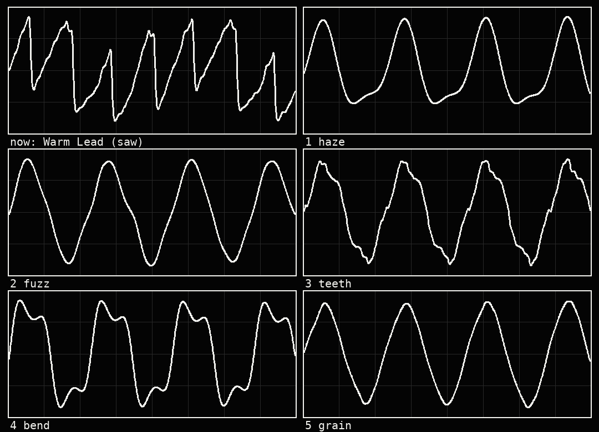
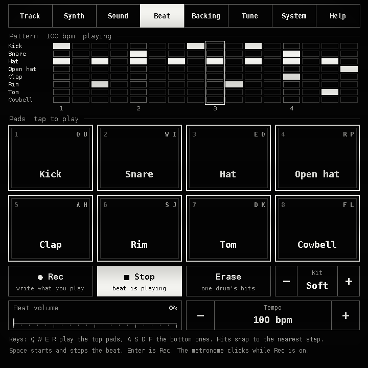
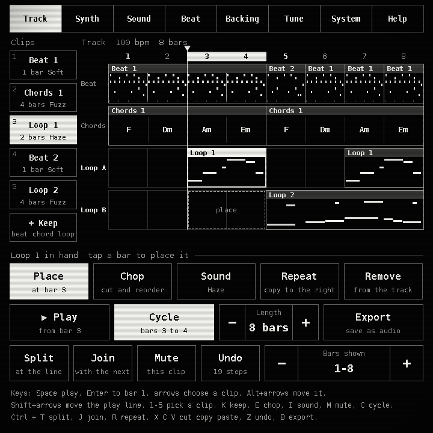
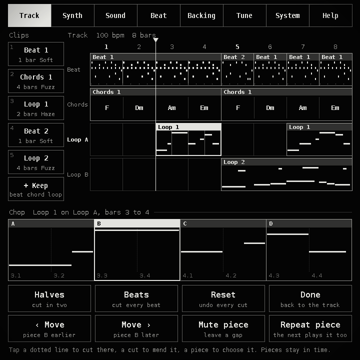
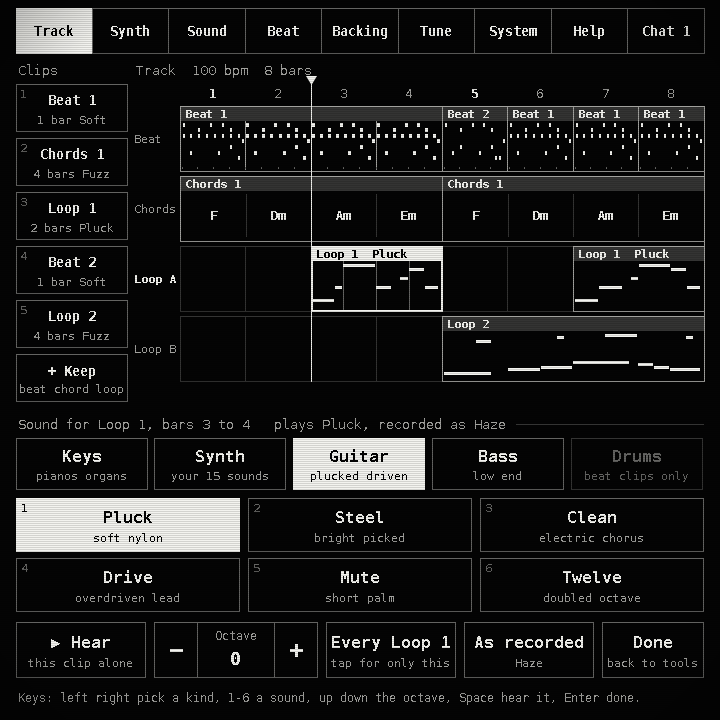
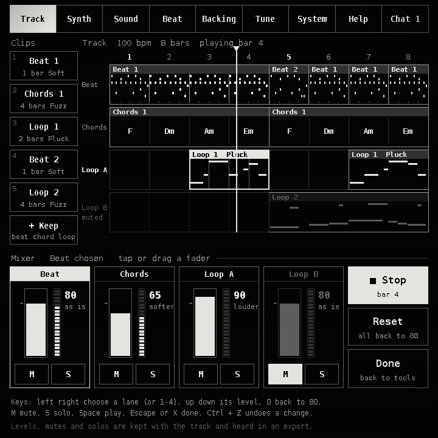
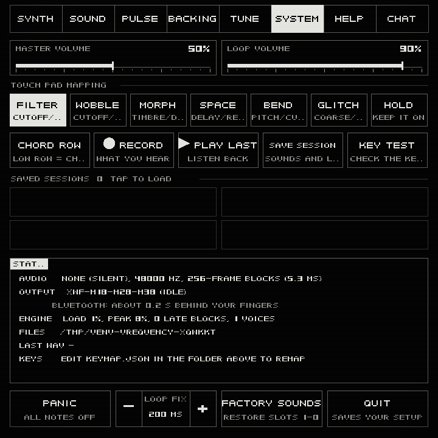
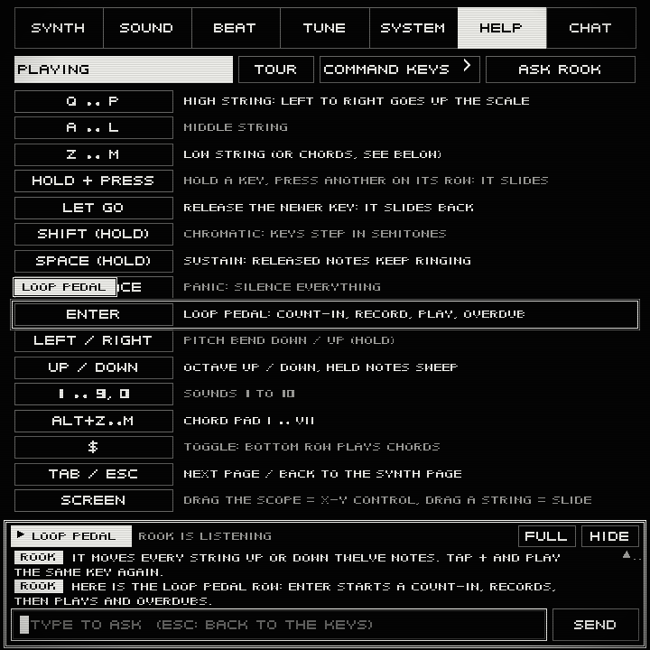
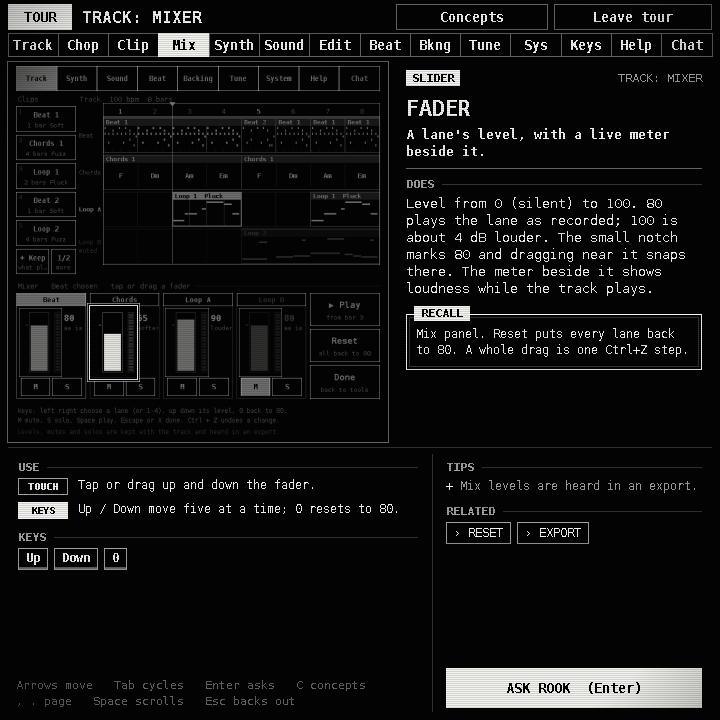

# How to use venv-vrequency

A guide to playing the synth, page by page. Everything here describes version 0.13.0 with the
default key bindings.

The short version is also built into the app: press `Ctrl`+`H`, or tap Menu and then the Help tab.

## Contents

1. [Start and quit](#1-start-and-quit)
2. [Your first minute](#2-your-first-minute)
3. [The Synth page](#3-the-synth-page)
4. [Playing the strings](#4-playing-the-strings)
5. [The scope and touch pad](#5-the-scope-and-touch-pad)
6. [Sounds](#6-sounds)
7. [Backing chords](#7-backing-chords)
8. [Beat](#8-beat)
9. [The loop pedal](#9-the-loop-pedal)
10. [Track](#10-track)
11. [Key, scale and tempo](#11-key-scale-and-tempo)
12. [Saving and recording](#12-saving-and-recording)
13. [System page](#13-system-page)
14. [All the keys](#14-all-the-keys)
15. [When something is wrong](#15-when-something-is-wrong)
16. [Chat with a copilot](#16-chat-with-a-copilot)
17. [Asking Rook while you play (the chat dock)](#17-asking-rook-while-you-play-the-chat-dock)
18. [The tour](#18-the-tour)

## 1. Start and quit

Start it from the app grid ("venv-vrequency"), or from a terminal:

```bash
vrequency
```

It opens full screen. To quit, press `Ctrl`+`Q`, or tap Menu, then System, then Quit. Quitting
saves your setup (sounds, key, tempo, settings) and it comes back the same next time.

`vrequency --windowed` runs it in a 720×720 window instead.

## 2. Your first minute

1. Press `A`, then `S`, then `D`. Each key is a note on the middle string.
2. Hold `A` and press `F` while still holding. The note slides up instead of starting again.
   Let go of `F` and it slides back to `A`.
3. Press `1` to `9` and `0` to try the ten sounds. On the Q20 the digits are on the number layer.
4. Drag a finger across the scope at the top of the screen. That changes the tone.
5. Tap two or three of the chord pads (Am, C, Em ...). The first tap starts the backing, and the
   chords loop as you add them, so you can play over them. (The Play button next to the pads stops
   it, and starts it again.)
6. Press `Backspace` if anything gets stuck. It silences everything.

Every key is locked to a scale, so nothing you press is a wrong note.

## 3. The Synth page

This is the instrument itself, and the page the app opens on. Its tab is called Synth.


From top to bottom:

| Part | What it shows | What tapping it does |
|---|---|---|
| Header, left | Sound name, slot number, how many voices are sounding | Opens the Sound page |
| Header, right | Key, scale, tempo with a beat lamp, octave | Opens the Tune page |
| Level strip | Output level, as a row of segments | Nothing |
| Scope | The real output wave, with frequency and level readouts | Dragging is the touch pad (section 5) |
| Strings | Three strings with each note's key letter above it | Press to play, drag to slide |
| Progression strip | The chords you have queued, up to eight | Tap a filled slot to select it |
| Chord pads | The seven chords of the current key | Adds or plays a chord (section 7) |
| Bottom row | Loop, Undo, loop play/stop, Sus, octave − and +, New, Menu | See below |

The bottom row:

- **Loop**: the loop pedal (section 9).
- **Undo**: removes the last loop layer.
- **▶ / ■**: starts or stops the loop.
- **Sus**: sustain stays on until you tap it again.
- **− / +**: octave down or up.
- **New**: invents a new random sound.
- **Menu**: opens the Sound page, which has the tab strip along the top for all the other pages:
  Track, Synth, Sound, Beat, Backing, Tune, System, Help and Chat, in that order.

`Tab` steps through the pages and `Esc` returns to Synth.

A small tag can appear under the sound name: "Limit" when the output is loud enough to be held
back, "REC" while recording to a file, and "No audio device" when there is nothing to play through.

## 4. Playing the strings

The three letter rows of the keyboard are three strings. Left to right goes up the scale.

| Keys | String |
|---|---|
| `Q` to `P` | High |
| `A` to `L` | Middle |
| `Z` to `M` | Low |

- **Slide:** hold one key and press another on the same row. The pitch glides to the new note
  without restarting. Release the newer key and it glides back.
- **Chords that glide:** hold a shape across two or three rows and move your fingers to a new shape.
  Each string slides to its new note.
- **Sustain:** hold `Space`. Released notes keep ringing, and new keys on a ringing string slide it.
- **Chromatic:** hold `Shift`. Keys then step in semitones, which lets you reach notes outside the scale.
- **Bend:** hold `Left` or `Right` (also `[` and `]`) to bend the pitch down or up.
- **Octave:** `Up` and `Down` (also `=` and `-`). Held notes sweep to the new octave.
- **Touch:** press a note box on screen to play it, and drag along the string to slide.

Notes with a bright frame are the root of the key. While a string sounds, a pair of brackets shows
where the pitch really is, so you can watch a slide travel.

On the Q20 the arrows and digits are on the symbol and number layers.

## 5. The scope and touch pad

The scope shows the sound actually leaving the synth. It holds the wave still and picks its own
scale. The readouts along its edges are the scale per division, the measured frequency and note,
and the level. None of this changes the sound.

Dragging on the scope does change the sound. Left to right is one control (X) and bottom to top is
another (Y). The button in the scope's corner shows which pair is active, and tapping it moves to
the next pair. `Ctrl`+`G` does the same.

| Mapping | Left to right (X) | Bottom to top (Y) |
|---|---|---|
| Filter | Cutoff | Resonance |
| Wobble | Cutoff | Vibrato |
| Morph | Timbre | Drive |
| Space | Delay | Reverb |
| Bend | Pitch | Cutoff |
| Glitch | Coarse | Grit |

**Hold** (next to it) keeps the position when you lift your finger. With Hold off, the sound
returns to normal when you let go.

### Glitch


Glitch crushes everything you hear (lead, backing and loop) into a rough, low-quality digital
sound for as long as your finger is on the pad.

- **Left to right (Coarse):** the sound gets blockier and more metallic.
- **Bottom to top (Grit):** the sound gets rougher and noisier.

While it is on, the scope leaves coloured copies of the wave streaking away diagonally. The white
wave on top is still the real sound, which now looks like steps. Further right makes the streaks
spread wider, and further up makes them last longer. Lift your finger and both the sound and the
picture go back to normal. `Backspace` (panic) also switches it off.

## 6. Sounds


**Pick a sound.** Tap one of the ten slots, or press `1` to `9` and `0`.

**Make a new one.**

- **New sound** (`Ctrl`+`R`) invents a complete new instrument.
- **Mutate** (`Ctrl`+`N`) changes the current sound a little.
- **Undo** (`Ctrl`+`Z`) goes back one step. The button shows how many steps are stored.

**Shape it.** The eight sliders are the quick controls: Cutoff, Reso, Attack, Release, Glide,
Drive, Delay and Reverb. Drag one to change it. **All parameters** swaps them for every parameter
the sound has, twelve to a page, with Prev and Next at the bottom.

**Keep it.** There are two places:

- **A slot.** Tap **Store**, then tap the slot to put it in. This replaces what was in that slot and cannot be undone.
- **A favourite.** Tap **Save** (`Ctrl`+`F`). Favourites are listed at the bottom of the page, six
  to a page. Tap one to recall it. The page button shows `‹ 1/2 ›`: tap its left half to go back a page,
  its right half to go forward; both wrap round. To remove one, tap **Delete** and then the favourite.
  Saving under a name you already use updates that favourite (the toast says "Updated ...") instead of
  adding a copy. Delete, Store and Erase only stay armed while you stay on their page.

Factory sounds can be put back at any time: System page, **Factory sounds**. That overwrites slots
1 to 0. It leaves your own favourites alone and puts back any of the five dream sounds you deleted.

### Dream sounds

Five favourites are there from the first start: **Haze**, **Fuzz**, **Teeth**, **Bend** and
**Grain**. They are for slow, soft, washed-out playing. Each is built around a sine wave, so the
scope draws a round wave instead of the jagged one Warm Lead makes, and each adds its own kind of buzz.



| Sound | What it is |
|---|---|
| Haze | A sine with a quiet sine an octave above it. The plainest of the five. |
| Fuzz | A sine pushed into soft distortion, with a low note underneath. |
| Teeth | A sine with a quiet, bright sawtooth riding on it, which shows as small teeth on the wave. |
| Bend | A sine whose shape is bent by a second sine. The dents drift slowly as you hold a note. |
| Grain | A triangle and a sine that beat against each other, with a little hiss and a slow tremolo. |

All five fade in gently, ring on for a couple of seconds after you let go, wobble slowly in pitch
and sit in a lot of chorus, echo and reverb. They suit held notes, slides and chords on three
strings more than fast playing. If the wash is too much, pull **Reverb** and **Delay** down.

To put one on a number key: tap it, tap **Store**, then tap a slot. If you delete one, it stays
deleted until you use **Factory sounds** on the System page.

## 7. Backing chords


The seven chord pads are the chords that belong to the current key. What a tap does depends on the
mode, shown on the small button beside the pads on the Synth page (tap it to change) and as three
buttons at the top of the Backing page:

| Mode | A chord tap ... |
|---|---|
| Progression | Adds the chord to a looping sequence of up to eight |
| Hold | Plays that one chord until you pick another |
| Drone | Switches a drone note for that chord on or off |

To build a progression:

1. Make sure the mode is Progression.
2. Tap chords in the order you want. They fill the strip. The first chord tap already starts the
   backing, and the loop grows as you add chords.
3. **Play** stops the backing, and starts it again from the first chord. Tapping it while the
   backing is already running stops it.

To change one chord, tap its slot and then tap the new chord. **Remove last** and **Clear all** are
on the Backing page.

Also on the Backing page:

- **Style**: Sustain, Pulse, Arp up, Arp down, Arp up-dn.
- **7th chords**: four-note chords instead of three.
- **Beats per chord** and **Arp steps per beat** (the arpeggio styles only; Pulse always strikes once per beat).
- **Tempo**, **Metronome** and **Backing volume**.
- **Use the current lead sound for the backing**. The backing keeps the sound it started with, so
  you can change the lead without changing the chords. Tap this when you do want them to match.

From the keyboard, hold `Alt` and press `Z` to `M` for chords one to seven. `$` turns the whole
bottom row into chord keys until you press it again.

## 8. Beat



The Beat page is a small drum machine: eight drums, one bar of sixteen steps, three kits.

**Play the pads.** Tap a pad, or use the keyboard:

| Pads | Left hand | Right hand |
|---|---|---|
| 1 to 4: Kick, Snare, Hat, Open hat | `Q` `W` `E` `R` | `U` `I` `O` `P` |
| 5 to 8: Clap, Rim, Tom, Cowbell | `A` `S` `D` `F` | `H` `J` `K` `L` |

Each pad shows its two keys in the corner. Two keys per pad let you play fast repeats with two
fingers. While you are on this page the bottom row (`Z`‥`M`) still plays the low string.

**Make a beat.**

1. Tap **Rec** (or press `Enter`). The beat starts and the metronome clicks.
2. Play the pads in time. Each hit is written into the bar at the nearest step and plays back
   the next time round. The strip at the top shows the whole bar; the box moving across it is
   the step that is sounding.
3. Tap **Rec** again to stop writing. The beat keeps playing, and the pads now play without
   changing it.

**Fix it.** Tap **Erase**, then the pad of the drum you want to clear. Only that drum's hits go.

**Play / Stop** (`Space` on this page) starts and stops the beat. From any other page, `Ctrl`+`J`
starts and stops it and `Ctrl`+`I` switches Rec.

**Keep several beats.** The row under the pads holds every beat you have made, like the patterns
of a drum machine. The beat shown at the top is the one lit in the row, and whatever you do to it is
kept in its place as you go: there is nothing to save by hand.

| To | Do |
|---|---|
| Start a fresh beat and keep the one you have | Tap **+ New**. The new beat is empty and uses the kit you have now |
| Go back to another beat | Tap it, or press `Left` / `Right` for the beat before or after |
| See more than seven | Tap **More**: the row shows six beats a page, then More and + New |

When the beat is playing, the one you tap starts on the next bar line, so it stays in time; until
then it shows "next bar". Stopped, it changes at once. Each beat keeps its own kit; the tempo and
the beat volume are shared by all of them. There is no limit to how many you keep, and they are
saved a moment after each change. A beat cannot be deleted or renamed yet.

**Kit** chooses the drum sounds: Soft (round and quiet, with a little room), Crunchy (driven and
lo-fi) or Glitchy (zaps and crushed noise). **Beat volume** and **Tempo** are underneath.

The beat follows the tempo and shares its bar lines with the backing chords and the loop pedal, so
they stay together whichever you start first. The Glitch touch-pad mapping crushes the drums along
with everything else. Every kept beat is saved a moment after it changes; a saved session holds
the beat shown, not the whole row.

Things it does not do yet: more than one bar, placing a hit by tapping the strip, and louder or
quieter hits. The loop pedal does not record the pads.

## 9. The loop pedal

One button, or the `Enter` key, does everything. The Loop button on the Synth page always says what
the next tap will do.

1. Press `Enter`. The button counts you in.
2. Play. The button shows REC and the bar number.
3. Press `Enter` again. Recording runs to the end of the bar, then your phrase loops.
4. Press `Enter` again to add a layer on top (DUB), and once more to finish the layer.

| Do this | Key | Button |
|---|---|---|
| Remove the last layer | `Ctrl`+`U` | Undo |
| Stop or restart the loop | `Ctrl`+`L` | ▶ / ■ |
| Erase the loop | `Ctrl`+`D` | (keyboard only) |

A loop can be up to 64 bars with six layers. Each layer remembers the sound it was played with,
and the loop follows the tempo if you change it.

Loop volume is on the System page.

## 10. Track

The Track page is where a beat, some chords and a loop or two become a piece of music. It is the
first tab.



**Clips.** A clip is a copy of something you made on another page: the beat, the backing's chords,
or the loop. Make one of those, come to the Track page and tap **+ Keep**. Each thing that is not
already on the shelf is added as a clip (Beat 1, Chords 1, Loop 1 ...). The original is untouched,
so you can change the beat, keep again and have Beat 2.

**Lanes.** The track has four lanes, and each kind of clip has its place:

| Lane | Takes | Sounds like |
|---|---|---|
| Beat | Beat clips | The drums, in the kit the beat was kept with (or the kit you pick with **Sound**) |
| Chords | Chords clips | The backing, with the sound and style it was kept with |
| Loop A, Loop B | Loop clips | The loop, every layer with its own sound. Two lanes, so two loops can play at once |

Any placed clip can be given another sound afterwards: see **Sound** below.

**Placing.**

1. Tap a clip on the shelf. It is now "in hand" (shown inverted).
2. Tap an empty bar in its lane. The clip is placed there. Tap more bars to place it again.
3. Or tap **Place**: it goes at the play line, and the line moves on, so tapping Place four times
   lays down four in a row. The dashed box shows where it will go.

Clips snap to whole bars and two clips cannot share bars in one lane. The track grows when you
place past its end; **Length** sets how many bars it has.

**Choosing and moving.** Tap a placed clip to choose it (double frame). Drag it left or right to
move it, or between Loop A and Loop B.

| Button | Does |
|---|---|
| **Repeat** | Puts a copy right after the chosen clip |
| **Split** | Cuts the chosen clip in two at the play line. Each half can then be moved or removed |
| **Join** | Joins the chosen clip with the one right after it, if that one carries on from it (a repeat, or the other half of a split) |
| **Mute** | Silences the chosen clip without removing it |
| **Remove** | Removes the chosen clip from the track. With a shelf clip in hand and nothing chosen, it deletes the clip and every copy of it, and asks twice |
| **Undo** | Takes back the last change, up to 40 steps |

**Playing.** Tap the numbers above the lanes to put the play line on a bar. **Play** starts from
there and goes round the whole track until you stop it. **Cycle** goes round just the chosen clip's
bars (or four bars from the play line); the cycled bars show inverted in the ruler. Starting the
track stops the live beat, backing and loop. While it plays you can go to the Synth page and play
over it, start the live beat on top, or record a new loop in time with it. `Ctrl`+`Space` starts
and stops the track from any page.

**Chop.** Choose a placed clip and tap **Chop**.



The strip shows one pass of the clip. Tap a dotted line to cut there; tap a cut to mend it. Tap a
piece to choose it, then:

- **‹ Move** and **Move ›** swap it with its neighbour, so the clip plays in a new order.
- **Mute piece** leaves a gap.
- **Repeat piece** makes the next piece play the same material again.
- **Halves** and **Beats** make the usual cuts for you. **Reset** undoes every cut.

Pieces always stay in time: the clip keeps its length whatever you do. Chopping changes only that
one placed copy, not the clip on the shelf.

**Sound.** Choose a placed clip and tap **Sound** to play it with another instrument. What you
recorded is not changed: the clip remembers its own sound, and **As recorded** brings it back.



The top row is the kind of sound, the six cells under it are the sounds of that kind:

| Kind | What is in it |
|---|---|
| **Keys** | E-piano, Soft keys, Organ, Toy keys, Clav, Strings |
| **Synth** | Your own sounds: slots 1 to 0, then your favourites. With more than six, the last cell turns the page |
| **Guitar** | Pluck, Steel, Clean, Drive, Mute, Twelve |
| **Bass** | Sub, Round, Pick, Acid, Growl, Hollow. Picking one drops the clip an octave |
| **Drums** | For beat clips only: the three kits |

Tap a cell and the clip plays in that sound. If nothing is playing, the clip starts going round on
its own so you can hear it; **Hear** starts and stops that. If the track is already playing, the
change is heard in place.

| Button | Does |
|---|---|
| **Hear** | Plays the chosen clip alone, round and round. Everything else on the track is silent meanwhile |
| **Octave** | Moves the clip's notes up or down, two octaves each way. Works with the recorded sound too. Not for beats |
| **Every Loop 1** / **Only this one** | Who gets the sound: every placed copy of the clip and the clip on the shelf, or just the chosen copy. Tap to switch. The chosen copy keeps what it plays either way |
| **As recorded** | Back to the sound (or kit) the clip was kept with, and the octave it was played in |
| **Done** | Back to the tools |

A clip with a picked sound shows its name beside the clip's name on the lane. A loop with several
layers plays every layer in the picked sound, and sound changes you made while recording it are
passed over. A chords clip keeps its chords and style and changes only the backing's sound.

The Keys, Guitar and Bass sounds are made with the same synth voice as everything else, shaped to
suggest those instruments. They are not recordings of real ones.

**Mix.** Tap **Mix** (or press `X`, as in Logic) and the tools under the lanes become a mixer: a
strip for each lane.



| On a strip | What it does |
|---|---|
| The fader | Tap or drag it to set the lane's level. **80** plays the lane as it was recorded; **100** is about 4 dB louder; **0** is silent. The small notch beside it marks 80, and dragging near it snaps there |
| The meter | How loud the lane is right now, while the track plays |
| **M** | Mute: the lane goes quiet, and on the lanes above its name says "muted" and its clips go faint |
| **S** | Solo: only soloed lanes are heard. Solo two lanes to hear just those two. The others say "off" |

**Reset** puts every lane back to 80, unmuted and unsoloed. **Play** works as it does in the tools,
and **Done** (or `Esc`, `Enter` or `X` again) closes the mixer. Every change is one step of
**Undo**, a whole fader drag included. The mix is saved with the track and is heard in an export.
**Hear** in the sound picker plays its clip whatever the mixer says.

| Key, while the mixer is open | Does |
|---|---|
| `Left` / `Right`, or `1`‥`4` | Choose a lane |
| `Up` / `Down` | Its level, five at a time |
| `0` | Its level back to 80 |
| `M` / `S` | Mute / solo it |
| `Esc`, `Enter` or `X` | Close the mixer |

The mixer sets the track's lanes only. What you play live on the other pages keeps its own levels
(Synth, Beat and Backing volumes on the System page).

**Export.** Tap **Export** to write the whole track to a WAV file in `recordings/`. It plays once
from bar 1 to the end, ignoring the cycle, at full master volume, and runs on until the echoes have
died away. It is done in the background, much faster than real time, and does not need the speaker.
**Play last** on the System page then plays it.

**Keys.** On this page letters are commands, not notes, and they follow the usual shortcuts of
desktop music programs (`Ctrl` where a Mac uses Cmd):

| Key | Does |
|---|---|
| `Space` | Play / stop |
| `Enter` | Play line back to bar 1 |
| `Shift`+`Left` / `Right`, or `,` / `.` | Play line a bar back / on |
| `Left` / `Right` | Choose the clip before / after |
| `Up` / `Down` | Choose a clip on the lane above / below |
| `Alt`+arrows | Move the chosen clip a bar, or to the other loop lane |
| `1`‥`5` | Take that shelf clip in hand |
| `Ctrl`+`V` | Paste: place the clip in hand at the play line |
| `Ctrl`+`X` / `Ctrl`+`C` | Cut / copy the chosen clip (with its chops) into your hand |
| `Ctrl`+`T` / `Ctrl`+`J` | Split at the play line / join |
| `Ctrl`+`R` | Repeat |
| `Ctrl`+`Z` / `Shift`+`Ctrl`+`Z` | Undo / redo |
| `Backspace` | Delete the chosen clip (with nothing chosen it is Panic, as everywhere) |
| `M` / `C` | Mute / cycle on and off |
| `E` | Chop (again, or `Esc`, closes it) |
| `I` | Sound: pick an instrument for the chosen clip |
| `K` | Keep |
| `X` | Mix: open or close the mixer |
| `Ctrl`+`B` | Export |
| `Esc` | Put down the clip in hand; with nothing in hand, back to Synth |

While Chop is open, `Left` / `Right` choose a piece, `Alt`+`Left` / `Right` move it, `M` mutes it,
`Ctrl`+`T` cuts it in half, `Ctrl`+`J` mends it with the next and `Ctrl`+`R` repeats it.

While Sound is open, `Left` / `Right` pick the kind, `1`‥`6` pick a sound (or turn the page),
`Up` / `Down` move the octave, `Space` starts and stops Hear, `Backspace` goes back to the recorded
sound, and `Enter`, `Esc` or `I` close it.

Because the letters are commands here, `Ctrl`+`T` (tap tempo), `Ctrl`+`R` (new sound), `Ctrl`+`Z`
(undo sound), `Ctrl`+`X` (clear backing), `Ctrl`+`J` (beat) and `Ctrl`+`B` (backing mode) mean the
things above while you are on this page.

The track is saved a moment after every change, and inside sessions.

Things it does not do yet: clips shorter than a bar or placed off the bar line, a different sound for each layer of one loop, more than one beat lane, and tempo or key
changes inside a track. Chords clips follow the key and scale you are in now, and every clip follows the
current tempo.

## 11. Key, scale and tempo


- **Key**: tap one of the twelve notes. `Ctrl`+`K` steps up a semitone.
- **Scale**: Major, Natural minor, Major pentatonic, Minor pentatonic, Blues, Dorian, Mixolydian,
  Chromatic. `Ctrl`+`S` steps to the next one. With `Shift` held as well, both shortcuts go the
  other way.
- **Octave**: moves the whole instrument up or down.
- **String gap**: how far apart the three strings are tuned, in semitones.
- **Bend range**: how far the bend keys move the pitch.
- **Tempo**: the − and + buttons, or tap the **Tap** button in time (`Ctrl`+`T`).
- **Click**: the metronome (`Ctrl`+`M`).
- **Glide speed**: makes every slide faster or slower. All the way down is instant.

**Listen** tries to work out the key and tempo of music playing nearby. It needs a microphone,
and this Hackberry does not have one, so it will say so.

## 12. Saving and recording

Everything is kept in the `vrequency` folder in your home folder.

| What | How | Where it goes |
|---|---|---|
| Your setup | Automatic when you quit | `state.json` |
| A favourite sound | Sound page, Save, or `Ctrl`+`F` | `favourites/` |
| A session: sounds, backing, loops, the beat and the track together | System page, Save session | `sessions/` |
| A recording of what you hear | System page, Record, or `Ctrl`+`E`. The same again stops it. | `recordings/` |
| The track as audio | Track page, Export, or `Ctrl`+`B` there | `recordings/track-….wav` |
| The track itself | Automatic, a moment after each change, and inside sessions | `state.json`, `sessions/` |

**Listening back.** System page, **Play last** (or `Ctrl`+`W`) plays your newest recording through
the speaker. The same again stops it. You can play along while it runs.

To load a session, tap it in the list on the System page, then start the loop, backing or beat.

## 13. System page



- **Master volume** and **Loop volume**.
- **Touch pad mapping** and **Hold**: the same as the buttons on the scope.
- **Chord row**: the bottom letter row plays chords (same as `$`).
- **Record**, **Play last** (listen to the newest recording), **Save session** and the list of saved sessions.
- **Key test**: shows which keys the keyboard reports, for checking how many it can read at once.
- **Status**: the audio device in use, how hard the engine is working, and where files are kept.
- **Panic**: all notes off (same as `Backspace`).
- **Loop fix**: shifts recorded loops earlier or later in milliseconds. Change it if your loops
  play back out of time with what you played.
- **Factory sounds**: restores slots 1 to 0 and puts back any deleted dream sounds.
- **Quit**.

## 14. All the keys

Playing:

| Key | Does |
|---|---|
| `Q`‥`P`, `A`‥`L`, `Z`‥`M` | High, middle and low strings |
| `Shift` (hold) | Chromatic |
| `Space` (hold) | Sustain |
| `Backspace` | Panic |
| `Enter` | Loop pedal |
| `Left` / `Right`, or `[` / `]` | Bend down / up |
| `Down` / `Up`, or `-` / `=` | Octave down / up |
| `1`‥`9`, `0` | Sounds 1 to 10 |
| `Alt` + `Z`‥`M` | Backing chords |
| `$` | Bottom row plays chords, on and off |
| `Tab` / `Esc` | Next page / back to Synth |

Commands, with `Ctrl` held:

| Key | Does | Key | Does |
|---|---|---|---|
| `R` | New sound | `B` | Backing mode |
| `N` | Mutate | `A` | Backing style |
| `Z` | Undo sound | `P` | Backing play / stop |
| `F` | Save favourite | `X` | Clear backing |
| `K` | Key up | `Backspace` | Remove last chord |
| `S` | Next scale | `U` | Undo loop layer |
| `T` | Tap tempo | `L` | Loop play / stop |
| `M` | Metronome | `D` | Clear loop |
| `G` | Next touch-pad mapping | `E` | Record WAV |
| `J` | Beat play / stop | `W` | Play last recording |
| `I` | Beat Rec on / off | `Q` | Quit |
| `H` | Help | `Space` | Track play / stop |
| `Y` | Chat dock: ask Rook on this page (`Shift`: the Chat page) | | |

On the Beat page only:

| Key | Does |
|---|---|
| `Q` `W` `E` `R`, or `U` `I` `O` `P` | Pads 1 to 4 |
| `A` `S` `D` `F`, or `H` `J` `K` `L` | Pads 5 to 8 |
| `Space` | Beat play / stop |
| `Enter` | Rec on / off |

The Track page has its own keys: see section 10.

To change any binding, edit `keymap.json` in the `vrequency` folder and restart the app. Deleting
that file restores the defaults.

## 15. When something is wrong

| Problem | Try this |
|---|---|
| No sound, and "No audio device" under the sound name | The Bluetooth speaker has dropped. Reconnect it, then check Output on the System page. |
| Sound on a Bluetooth speaker plays well for a few seconds, then stutters, again and again | Close the Bluetooth settings window. While it is open the device keeps searching for other devices, and that interrupts the music. |
| A note is stuck | `Backspace`. |
| Notes come out late | Normal on the built-in speaker: it is Bluetooth and runs about 0.2 s behind. Wired headphones do not. |
| Loops play back early or late | System page, Loop fix. Adjust in steps until a recorded bar lines up. |
| Some keys do not sound when held together | Open Key test on the System page and hold the same keys. A key missing there is a limit of the keyboard, not the synth. |
| A slot was overwritten by mistake | Storing to a slot cannot be undone. Factory sounds on the System page puts the ten originals back, replacing anything else you stored in slots. |
| Letters do not play notes | You are on the Track page, where letters are commands. `Esc` goes back to Synth. |
| + Keep says there is nothing to keep | Make a beat (Beat page), tap some chords (Backing page) or record a loop first. Keep copies what exists now. |
| A clip will not go where I tap | Those bars are taken in that lane, or the clip is the wrong kind for the lane. Loops go on Loop A or Loop B, beats on Beat, chords on Chords. |
| My drum hits land on the wrong step | The Bluetooth speaker is late, so you hit late. System page, Loop fix moves recorded hits earlier; raise it if hits land a step late, lower it if early. |
| The sound is distorted or quiet with "Limit" showing | Lower Master volume, or the sound's Drive. |

To reconnect the speaker from a terminal, list the paired devices to find its address
(the Hackberry's built-in speaker is the one named `XWF-M18-M28-M38`), then connect to it:

```bash
bluetoothctl devices
```

```bash
bluetoothctl connect XX:XX:XX:XX:XX:XX
```

## 16. Chat with a copilot


The last tab, **Chat**, is a conversation between you and an AI copilot (for example the agent Rook, or
Claude Code) that is connected to the app through its control socket. It can play notes, change the sound,
set up a beat or a backing and look at the screen while you talk. The commands it uses are in
[CONTROL.md](CONTROL.md). The socket is a local file only your user can open; `vrequency --no-control`
switches it off, and then the Chat page simply stays quiet.

- **Type** on the keyboard: on this page letters type instead of playing strings. `Enter` sends,
  `Backspace` deletes a letter, `Up` / `Down` (or a finger drag on the history) scroll, `Esc` leaves the page.
  The **Send** button sends by touch. `Tab` and the `Ctrl` commands still work.
- **Hotkey**: `Ctrl`+`Shift`+`Y` jumps to this page from any page, and `Ctrl`+`Y` here takes you back to where
  you were. (On the other pages `Ctrl`+`Y` opens the chat dock instead, chapter 17. It is bound as `chat`
  in `keymap.json`; the other `Ctrl` letters are unchanged.)
- The copilot's messages have a white tag with its name; yours have an outlined `YOU`. A `?` after the
  name means it is asking you something, `tip` marks a suggestion.
- **The ticker**: when the copilot says something while you are on another page, the message appears in a
  two-line strip at the bottom of the screen for about seven seconds, and the Chat tab shows how many are
  unread (`Chat 2`). It never takes the keyboard away, so you can keep playing; it does cover the
  bottom row of controls while it shows. Touch it, or press `Ctrl`+`Y`, to answer in the chat dock (chapter 17).
- **`copilot: listening`** at the top right means a copilot is connected and waiting for you
  (it has asked for your messages in the last 45 seconds, or is waiting right now); otherwise it says
  `copilot: not connected`. Messages you type then wait for it: they are kept.
- The last 200 messages are kept between runs.


## 17. Asking Rook while you play (the chat dock)


You do not have to leave the page you are on to talk to the copilot. Press `Ctrl`+`Y` on any page
except Chat and a **dock** opens over the bottom of the screen: the last two or three messages, an
input line and Send. The page behind it stays visible and keeps working above the dock.

- **Keys.** `Ctrl`+`Y` opens the dock and gives it the keyboard: letters type (they do not play strings),
  `Enter` sends, `Backspace` deletes, `Up` / `Down` scroll. `Esc` gives the keyboard back to the page and
  leaves the dock showing, so the keys play again; `Esc` once more closes the dock. `Ctrl`+`Y` while the dock
  is open switches the keyboard between the two. `Ctrl`+`Shift`+`Y` opens the full Chat page. By touch:
  tap the input line to type, **Send**, **Full** (the Chat page), **Hide**.
- **From the ticker.** When Rook speaks while the dock is closed, the ticker shows the message; touch it, or
  press `Ctrl`+`Y`, to answer straight away.
- **Pointing.** Rook can ring the controls it is talking about with a pulsing double outline, sometimes with a
  small caption tag next to it. The dock's header then says what is being discussed (`▸ OCTAVE`). The highlight
  goes away after a few seconds, or as soon as you change page. If the dock would cover what Rook points at, it
  gets shorter or moves to the top of the screen. When you answer, your message tells Rook which page you
  were on and what was highlighted, so "what does this do?" works.
- **On the Help page** every row is touchable. Tap a row and the dock opens with the question already started
  ("What does "Enter: loop pedal ..." do?"); press `Enter`. **Ask Rook** at the top opens the dock for the section you
  are reading. Rook can highlight a row ("the Loop pedal row") while it explains.




Rook needs to be connected (the dock says `Rook is listening`); if it is not, your messages wait for it.
The commands Rook uses are in [CONTROL.md](CONTROL.md).

## 18. The tour


The tour is a picture of every page with a card for every control on it. Nothing in it is live: it never plays,
never changes your sound or settings, and the keys do not reach the synth while it is open.

**Opening it.** Tap **Tour** at the top of the Help page, or press `Ctrl`+`O` on any page. The first time the
app starts it offers the tour in a banner at the top (`Enter` takes it, `Esc` or waiting says later; it is only
offered once). Rook can also open it for you. It reopens on the page you left it on.

**Reading it.** The chips under the title pick the page (Track, Chop, Clip, Mix, Synth, Sound, Edit, Beat,
Bkng, Tune, Sys, Keys, Help, Chat). Tap any control in the picture: it is ringed with a pulsing double rule,
the rest dims, and the card on the right says what it does, how to use it by touch and by keys, and **Recall**,
which is where to find it again. **Related** chips jump to the next card. Readouts that are not buttons (the
level strip, scope readouts, the step grid, the Listen result, the status box, the key list rows) have cards
too. Tap empty space to clear. **Concepts** lists the ideas behind the controls (scale lock, tempo, bar lines...).
The Edit chip is the All parameters editor; its Prev and Next flip through the four parameter pages.

**Keys.** Arrows move between controls, `Tab` / `Shift`+`Tab` go in reading order, `,` and `.` change page,
`C` opens Concepts, `V` switches picture variant where a page has two (for example the sound picker on a beat
clip), `Space` or `Page Down` scrolls a long card, `Home` clears the selection, `Esc` closes a card, then the
concept list, then the selection, then the tour.

**Start here.** The first time, or from the banner, the tour walks ten pages in order (Synth, Sound, Tune,
Backing, Beat, Track, Mixer, System, Help, Chat) with Back, Next and **Explore freely**.

**Ask Rook.** The button at the bottom right leaves the tour, goes to the real page the card belongs to, and
opens the chat dock with a question already written (not sent). Press `Enter` to send it; Rook is told the
page and which control you were reading (`via` is `tour`).




The first time the tour opens in a run it draws its pictures (two or three seconds on the Pi; it says so).
The cards come from `docs/helpcards.json`, built into the program; a damaged file shows a "Help unavailable"
card, never a crash. `scripts/check_helpcards.py` checks that every control has a card.
