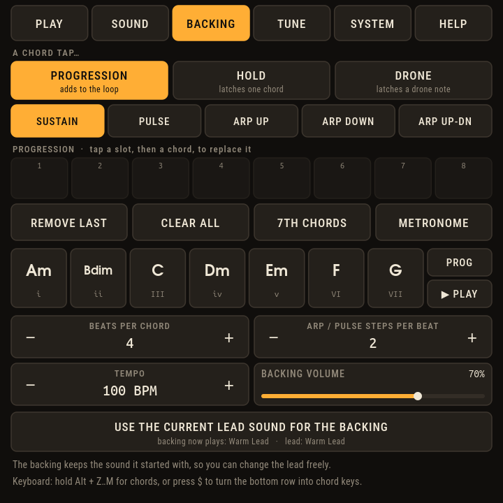
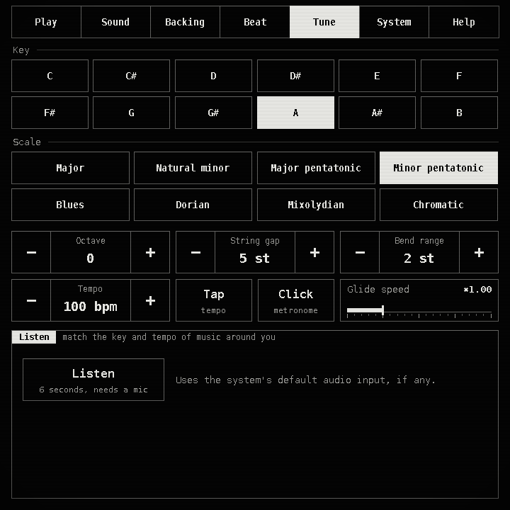

# How to use venv vrequency

A guide to playing the synth, page by page. Everything here describes version 0.4.0 with the
default key bindings.

The short version is also built into the app: press `Ctrl`+`H`, or tap Menu and then the Help tab.

## Contents

1. [Start and quit](#1-start-and-quit)
2. [Your first minute](#2-your-first-minute)
3. [The Play page](#3-the-play-page)
4. [Playing the strings](#4-playing-the-strings)
5. [The scope and touch pad](#5-the-scope-and-touch-pad)
6. [Sounds](#6-sounds)
7. [Backing chords](#7-backing-chords)
8. [The loop pedal](#8-the-loop-pedal)
9. [Key, scale and tempo](#9-key-scale-and-tempo)
10. [Saving and recording](#10-saving-and-recording)
11. [System page](#11-system-page)
12. [All the keys](#12-all-the-keys)
13. [When something is wrong](#13-when-something-is-wrong)

## 1. Start and quit

Start it from the app grid ("venv vrequency"), or from a terminal:

```bash
vrequency
```

It opens full screen. To quit, press `Ctrl`+`Q`, or tap Menu, then System, then Quit. Quitting
saves your setup (sounds, key, tempo, settings) and it comes back the same next time.

`vrequency --windowed` runs it in a 720×720 window instead.

## 2. Your first minute

1. Press `A`, then `S`, then `D`. Each key is a note on the middle string.
2. Hold `A` and press `F` while still holding. The note slides up instead of starting again.
   Let go of `F` and it slides back to `A`.
3. Press `1` to `9` and `0` to try the ten sounds. On the Q20 the digits are on the number layer.
4. Drag a finger across the scope at the top of the screen. That changes the tone.
5. Tap two or three of the chord pads (Am, C, Em ...), then tap Play next to them. The chords loop
   and you can play over them.
6. Press `Backspace` if anything gets stuck. It silences everything.

Every key is locked to a scale, so nothing you press is a wrong note.

## 3. The Play page


From top to bottom:

| Part | What it shows | What tapping it does |
|---|---|---|
| Header, left | Sound name, slot number, how many voices are sounding | Opens the Sound page |
| Header, right | Key, scale, tempo with a beat lamp, octave | Opens the Tune page |
| Level strip | Output level, as a row of segments | Nothing |
| Scope | The real output wave, with frequency and level readouts | Dragging is the touch pad (section 5) |
| Strings | Three strings with each note's key letter above it | Press to play, drag to slide |
| Progression strip | The chords you have queued, up to eight | Tap a filled slot to select it |
| Chord pads | The seven chords of the current key | Adds or plays a chord (section 7) |
| Bottom row | Loop, Undo, loop play/stop, Sus, octave − and +, New, Menu | See below |

The bottom row:

- **Loop**: the loop pedal (section 8).
- **Undo**: removes the last loop layer.
- **▶ / ■**: starts or stops the loop.
- **Sus**: sustain stays on until you tap it again.
- **− / +**: octave down or up.
- **New**: invents a new random sound.
- **Menu**: opens the other pages. They have tabs along the top: Play, Sound, Backing, Tune,
  System, Help.

`Tab` steps through the pages and `Esc` returns to Play.

A small tag can appear under the sound name: "Limit" when the output is loud enough to be held
back, "REC" while recording to a file, and "No audio device" when there is nothing to play through.

## 4. Playing the strings

The three letter rows of the keyboard are three strings. Left to right goes up the scale.

| Keys | String |
|---|---|
| `Q` to `P` | High |
| `A` to `L` | Middle |
| `Z` to `M` | Low |

- **Slide:** hold one key and press another on the same row. The pitch glides to the new note
  without restarting. Release the newer key and it glides back.
- **Chords that glide:** hold a shape across two or three rows and move your fingers to a new shape.
  Each string slides to its new note.
- **Sustain:** hold `Space`. Released notes keep ringing, and new keys on a ringing string slide it.
- **Chromatic:** hold `Shift`. Keys then step in semitones, which lets you reach notes outside the scale.
- **Bend:** hold `Left` or `Right` (also `[` and `]`) to bend the pitch down or up.
- **Octave:** `Up` and `Down` (also `=` and `-`). Held notes sweep to the new octave.
- **Touch:** press a note box on screen to play it, and drag along the string to slide.

Notes with a bright frame are the root of the key. While a string sounds, a pair of brackets shows
where the pitch really is, so you can watch a slide travel.

On the Q20 the arrows and digits are on the symbol and number layers.

## 5. The scope and touch pad

The scope shows the sound actually leaving the synth. It holds the wave still and picks its own
scale. The readouts along its edges are the scale per division, the measured frequency and note,
and the level. None of this changes the sound.

Dragging on the scope does change the sound. Left to right is one control (X) and bottom to top is
another (Y). The button in the scope's corner shows which pair is active, and tapping it moves to
the next pair. `Ctrl`+`G` does the same.

| Mapping | Left to right (X) | Bottom to top (Y) |
|---|---|---|
| Filter | Cutoff | Resonance |
| Wobble | Cutoff | Vibrato |
| Morph | Timbre | Drive |
| Space | Delay | Reverb |
| Bend | Pitch | Cutoff |
| Glitch | Coarse | Grit |

**Hold** (next to it) keeps the position when you lift your finger. With Hold off, the sound
returns to normal when you let go.

### Glitch


Glitch crushes everything you hear (lead, backing and loop) into a rough, low-quality digital
sound for as long as your finger is on the pad.

- **Left to right (Coarse):** the sound gets blockier and more metallic.
- **Bottom to top (Grit):** the sound gets rougher and noisier.

While it is on, the scope leaves coloured copies of the wave streaking away diagonally. The white
wave on top is still the real sound, which now looks like steps. Further right makes the streaks
spread wider, and further up makes them last longer. Lift your finger and both the sound and the
picture go back to normal. `Backspace` (panic) also switches it off.

## 6. Sounds


**Pick a sound.** Tap one of the ten slots, or press `1` to `9` and `0`.

**Make a new one.**

- **New sound** (`Ctrl`+`R`) invents a complete new instrument.
- **Mutate** (`Ctrl`+`N`) changes the current sound a little.
- **Undo** (`Ctrl`+`Z`) goes back one step. The button shows how many steps are stored.

**Shape it.** The eight sliders are the quick controls: Cutoff, Reso, Attack, Release, Glide,
Drive, Delay and Reverb. Drag one to change it. **All parameters** swaps them for every parameter
the sound has, twelve to a page, with Prev and Next at the bottom.

**Keep it.** There are two places:

- **A slot.** Tap **Store**, then tap the slot to put it in. This replaces what was in that slot and cannot be undone.
- **A favourite.** Tap **Save** (`Ctrl`+`F`). Favourites are listed at the bottom of the page, six
  to a page. Tap one to recall it. To remove one, tap **Delete** and then the favourite.

Factory sounds can be put back at any time: System page, **Factory sounds**. That overwrites slots
1 to 0 and leaves favourites alone.

## 7. Backing chords



The seven chord pads are the chords that belong to the current key. What a tap does depends on the
mode, shown on the small button beside the pads on the Play page (tap it to change) and as three
buttons at the top of the Backing page:

| Mode | A chord tap ... |
|---|---|
| Progression | Adds the chord to a looping sequence of up to eight |
| Hold | Plays that one chord until you pick another |
| Drone | Switches a drone note for that chord on or off |

To build a progression:

1. Make sure the mode is Progression.
2. Tap chords in the order you want. They fill the strip.
3. Tap **Play**. Tap it again to stop.

To change one chord, tap its slot and then tap the new chord. **Remove last** and **Clear all** are
on the Backing page.

Also on the Backing page:

- **Style**: Sustain, Pulse, Arp up, Arp down, Arp up-dn.
- **7th chords**: four-note chords instead of three.
- **Beats per chord** and **Arp / pulse steps per beat**.
- **Tempo**, **Metronome** and **Backing volume**.
- **Use the current lead sound for the backing**. The backing keeps the sound it started with, so
  you can change the lead without changing the chords. Tap this when you do want them to match.

From the keyboard, hold `Alt` and press `Z` to `M` for chords one to seven. `$` turns the whole
bottom row into chord keys until you press it again.

## 8. The loop pedal

One button, or the `Enter` key, does everything. The Loop button on the Play page always says what
the next tap will do.

1. Press `Enter`. The button counts you in.
2. Play. The button shows REC and the bar number.
3. Press `Enter` again. Recording runs to the end of the bar, then your phrase loops.
4. Press `Enter` again to add a layer on top (DUB), and once more to finish the layer.

| Do this | Key | Button |
|---|---|---|
| Remove the last layer | `Ctrl`+`U` | Undo |
| Stop or restart the loop | `Ctrl`+`L` | ▶ / ■ |
| Erase the loop | `Ctrl`+`D` | (keyboard only) |

A loop can be up to 64 bars with six layers. Each layer remembers the sound it was played with,
and the loop follows the tempo if you change it.

Loop volume is on the System page.

## 9. Key, scale and tempo



- **Key**: tap one of the twelve notes. `Ctrl`+`K` steps up a semitone.
- **Scale**: Major, Natural minor, Major pentatonic, Minor pentatonic, Blues, Dorian, Mixolydian,
  Chromatic. `Ctrl`+`S` steps to the next one. With `Shift` held as well, both shortcuts go the
  other way.
- **Octave**: moves the whole instrument up or down.
- **String gap**: how far apart the three strings are tuned, in semitones.
- **Bend range**: how far the bend keys move the pitch.
- **Tempo**: the − and + buttons, or tap the **Tap** button in time (`Ctrl`+`T`).
- **Click**: the metronome (`Ctrl`+`M`).
- **Glide speed**: makes every slide faster or slower. All the way down is instant.

**Listen** tries to work out the key and tempo of music playing nearby. It needs a microphone,
and this Hackberry does not have one, so it will say so.

## 10. Saving and recording

Everything is kept in the `vrequency` folder in your home folder.

| What | How | Where it goes |
|---|---|---|
| Your setup | Automatic when you quit | `state.json` |
| A favourite sound | Sound page, Save, or `Ctrl`+`F` | `favourites/` |
| A session: sounds, backing and loops together | System page, Save session | `sessions/` |
| A recording of what you hear | System page, Record WAV, or `Ctrl`+`E`. The same again stops it. | `recordings/` |

To load a session, tap it in the list on the System page, then start the loop or backing.

## 11. System page


- **Master volume** and **Loop volume**.
- **Touch pad mapping** and **Hold**: the same as the buttons on the scope.
- **Chord row**: the bottom letter row plays chords (same as `$`).
- **Record WAV**, **Save session** and the list of saved sessions.
- **Key test**: shows which keys the keyboard reports, for checking how many it can read at once.
- **Status**: the audio device in use, how hard the engine is working, and where files are kept.
- **Panic**: all notes off (same as `Backspace`).
- **Loop fix**: shifts recorded loops earlier or later in milliseconds. Change it if your loops
  play back out of time with what you played.
- **Factory sounds**: restores slots 1 to 0.
- **Quit**.

## 12. All the keys

Playing:

| Key | Does |
|---|---|
| `Q`‥`P`, `A`‥`L`, `Z`‥`M` | High, middle and low strings |
| `Shift` (hold) | Chromatic |
| `Space` (hold) | Sustain |
| `Backspace` | Panic |
| `Enter` | Loop pedal |
| `Left` / `Right`, or `[` / `]` | Bend down / up |
| `Down` / `Up`, or `-` / `=` | Octave down / up |
| `1`‥`9`, `0` | Sounds 1 to 10 |
| `Alt` + `Z`‥`M` | Backing chords |
| `$` | Bottom row plays chords, on and off |
| `Tab` / `Esc` | Next page / back to Play |

Commands, with `Ctrl` held:

| Key | Does | Key | Does |
|---|---|---|---|
| `R` | New sound | `B` | Backing mode |
| `N` | Mutate | `A` | Backing style |
| `Z` | Undo sound | `P` | Backing play / stop |
| `F` | Save favourite | `X` | Clear backing |
| `K` | Key up | `Backspace` | Remove last chord |
| `S` | Next scale | `U` | Undo loop layer |
| `T` | Tap tempo | `L` | Loop play / stop |
| `M` | Metronome | `D` | Clear loop |
| `G` | Next touch-pad mapping | `E` | Record WAV |
| `H` | Help | `Q` | Quit |

To change any binding, edit `keymap.json` in the `vrequency` folder and restart the app. Deleting
that file restores the defaults.

## 13. When something is wrong

| Problem | Try this |
|---|---|
| No sound, and "No audio device" under the sound name | The Bluetooth speaker has dropped. Reconnect it, then check Output on the System page. |
| A note is stuck | `Backspace`. |
| Notes come out late | Normal on the built-in speaker: it is Bluetooth and runs about 0.2 s behind. Wired headphones do not. |
| Loops play back early or late | System page, Loop fix. Adjust in steps until a recorded bar lines up. |
| Some keys do not sound when held together | Open Key test on the System page and hold the same keys. A key missing there is a limit of the keyboard, not the synth. |
| A slot was overwritten by mistake | Storing to a slot cannot be undone. Factory sounds on the System page puts the ten originals back, replacing anything else you stored in slots. |
| The sound is distorted or quiet with "Limit" showing | Lower Master volume, or the sound's Drive. |

To reconnect the speaker from a terminal:

```bash
bluetoothctl connect XX:XX:XX:XX:XX:XX
```
